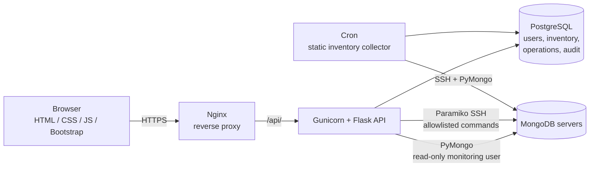

<div align="center">

# MongoFleet

**Enterprise-grade control plane for managing on-prem MongoDB fleets.**
Inventory, live health checks, and audited operations — in one console.


</div>

---

## Overview

MongoFleet gives DBA and SRE teams a single web console to **inventory, monitor, and operate** self-hosted MongoDB servers (standalone and replica sets) — the kind of workflow cloud-managed database consoles offer, built for on-prem estates.

Everything shown in the UI is **real**: no mock data, no hardcoded fallbacks. Where data has not been collected yet, the UI says so explicitly instead of fabricating values.

## Key Features

| Area | Capability |
|---|---|
| **Authentication & RBAC** | Session-based login, DB-backed users / roles / permissions (Admin, DBA, Viewer), no hardcoded accounts |
| **Server Inventory** | Full CRUD for registered MongoDB servers, with static metadata (FQDN, OS, CPU cores, memory, disk, Mongo version) collected by a scheduled job |
| **Live Health Checks** | Fresh SSH (Paramiko) + PyMongo pull on every page load: CPU, memory, uptime, connections, replication lag, `ping`, `serverStatus`, `replSetGetStatus` |
| **Dashboard** | Fleet summary computed from real PostgreSQL aggregates |
| **Audit Logging** | Every write action recorded with who, what, and when |
| **Operations Engine** | Operation model and state machine (`REQUESTED → … → SUCCESS`) for start / stop / restart / backup and more, with step-by-step execution logs |
| **Safety Controls** | Allowlisted SSH commands only; secrets loaded from environment, never committed |

## Architecture



**Two data paths, by design**

- **Live metrics** — pulled fresh on every request via SSH + PyMongo and never stored.
  `GET /api/inventory/servers/:id/live-metrics`
- **Static inventory** — read from PostgreSQL, written only by the scheduled collector `scripts/collect_static_inventory.py`.

## Tech Stack

- **Backend:** Python, Flask, SQLAlchemy, PostgreSQL, Paramiko, PyMongo, APScheduler
- **Frontend:** HTML, CSS, vanilla JavaScript, Bootstrap 5
- **Deployment:** Gunicorn, systemd, Nginx (RHEL-friendly, SELinux-aware)

## Repository Structure

```text
MongoFleet/
├── backend/            # Flask API, models, services, collectors
│   ├── deploy/         # Deployment guide (systemd, nginx, SELinux notes)
│   └── .env.example    # Environment variable template
├── frontend/           # Static UI (login, dashboard, inventory, server-detail, ...)
│   └── assets/         # api.js and shared assets
├── logs/               # Runtime logs
└── README.md
```

## Getting Started

### Prerequisites

- Linux host (RHEL 8+ recommended), Python 3.9+, PostgreSQL 13+
- Network access from the app host to your MongoDB servers (SSH + MongoDB port)
- A **read-only monitoring user** on each MongoDB instance
- An SSH user on managed servers permitted to run the allowlisted commands

### 1. Clone and install

```bash
git clone https://github.com/Madan-U/MongoFleet.git
cd MongoFleet/backend

python3 -m venv venv
source venv/bin/activate
pip install -r requirements.txt
```

### 2. Configure

```bash
cp .env.example .env
# Edit .env: database URL, secret key, SSH and Mongo credentials
```

> **Never commit `.env`.** In production, keep it outside the repo
> (for example `/etc/mongofleet/.env`, loaded via systemd `EnvironmentFile`).

### 3. Initialise the database and create the first admin

Create the PostgreSQL database and user, then run the app's table-creation / seed step as described in [`backend/deploy/README.md`](backend/deploy/README.md).

> When creating an admin password hash manually, generate it **inside the app's virtualenv**. A hash created with a different Werkzeug version can use a different algorithm and cause `401 invalid_credentials` at login.

### 4. Run

```bash
# Development
flask run

# Production
gunicorn -w 4 -b 127.0.0.1:8000 app:app
```

Serve `frontend/` and proxy `/api/` to Gunicorn through Nginx. See the deploy guide for the systemd unit and Nginx config.

### 5. Schedule the static inventory collector

```cron
*/5 * * * * /path/to/MongoFleet/backend/scripts/run_static_inventory_collect.sh
```

## Security

MongoFleet can execute real operations against production databases, so treat it accordingly.

- No credentials or secret keys are hardcoded; use `.env` and restrict file permissions
- Run the app as a dedicated **non-root** OS user
- Use **read-only** MongoDB users for monitoring; use separate, scoped credentials for operations
- SSH execution is restricted to an allowlist of commands
- Serve over **HTTPS** and set `SESSION_COOKIE_SECURE=true`; place behind VPN or IP restrictions
- All write actions are audit-logged
- **Rotate any password or key that has ever been pasted into a chat, ticket, or commit**

## Roadmap

- [x] Authentication, RBAC, audit logging
- [x] Inventory CRUD and dashboard summary
- [x] Live SSH + PyMongo health checks
- [x] Server detail with live metrics and static inventory
- [ ] Operations engine: restart, start, stop, backup with live step logs
- [ ] Scheduled operations (one-time and recurring)
- [ ] Notifications (email first; Slack / Teams later)
- [ ] Minor / major version upgrade workflow with pre-checks
- [ ] Failover and failback workflows
- [ ] Approval workflow for high-risk production operations
- [ ] Monitoring: replication, oplog, WiredTiger, slow queries, index stats
- [ ] Configuration drift detection against a baseline
- [ ] Pluggable collectors for MSSQL, MySQL, MariaDB, PostgreSQL

## Contributing

Issues and pull requests are welcome. For larger changes, please open an issue first to discuss the approach.

## License

This project is licensed under the MIT License. See the [LICENSE](LICENSE) file for details.

## Author

**Madan U** — Cloud DBA · [GitHub](https://github.com/Madan-U)
